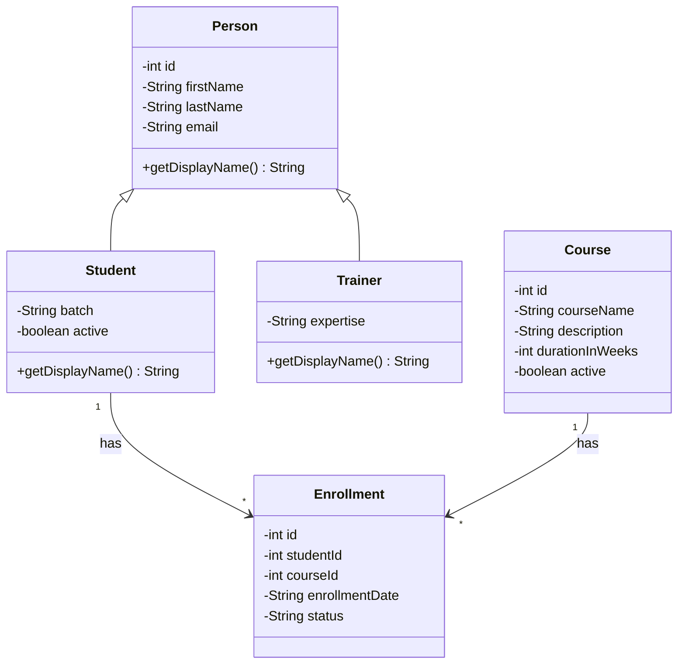
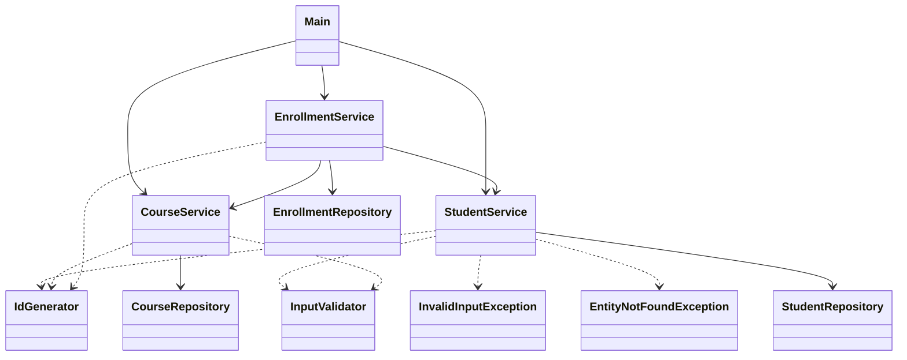

# LearnTrack – Student & Course Management System

LearnTrack is a console-based application written in Core Java. An admin can manage
**students**, **courses** and **enrollments** from a simple text menu. All data is kept
in memory (ArrayLists), so it is cleared when the program exits.

## Features

- **Students:** add, view all, search by ID, update, deactivate (soft delete)
- **Courses:** add, view all, activate / deactivate
- **Enrollments:** enroll a student in a course, view a student's enrollments, mark as completed / cancelled
- Invalid input (wrong menu option, text instead of a number, unknown IDs, empty lists) shows a clear message instead of crashing

## Project structure

```
src/com/airtribe/learntrack/
├── Main.java            menu and program entry point
├── entity/              Person, Student, Trainer, Course, Enrollment
├── repository/          in-memory storage (ArrayList) for each entity
├── service/             business logic: StudentService, CourseService, EnrollmentService
├── exception/           EntityNotFoundException, InvalidInputException
├── util/                IdGenerator, InputValidator
└── constants/           MenuOptions, AppConstants
docs/                    Setup_Instructions.md, JVM_Basics.md, Design_Notes.md
```

## How to compile and run

You need JDK 17 or newer. Run these commands from the project root folder.

**Windows (Command Prompt):**
```
dir /s /b src\*.java > sources.txt
javac -d out @sources.txt
java -cp out com.airtribe.learntrack.Main
```

**Linux / macOS:**
```
javac -d out $(find src -name "*.java")
java -cp out com.airtribe.learntrack.Main
```

You can also open the project in an IDE (IntelliJ / Eclipse / VS Code), mark `src` as the
source folder and run `Main.java`.

## Class diagram

### Entities



### Layers



## Concepts practised

Packages and access modifiers, classes and objects, constructors (including overloading),
encapsulation, inheritance (`Person` → `Student`, `Trainer`) with `super` and method
overriding, static members, ArrayList, control flow (menus with `switch`, `while`, `for`),
and basic exception handling with a custom exception.
