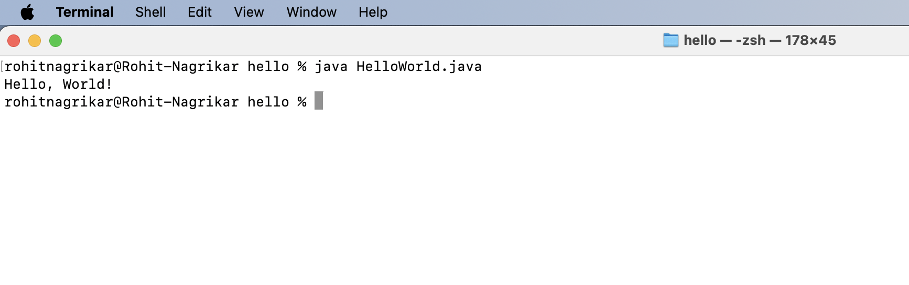

# Setup Instructions

## JDK version used

JDK version: 17.0.16

## Steps

1. Download and install a JDK (17 or newer) and make sure `java` and `javac` work in the terminal.
2. Check the installation:
   ```
   java -version
   javac -version
   ```
3. Create a file `HelloWorld.java`:
   ```java
   public class HelloWorld {
       public static void main(String[] args) {
           System.out.println("Hello, World!");
       }
   }
   ```
4. Compile and run it:
   ```

   javac HelloWorld.java
   java HelloWorld
   ```
   Output: `Hello, World!`

## Hello World screenshot


